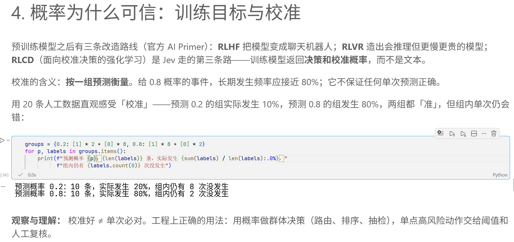

# 第一章 · 认识 Jev 学习笔记

> 章节：认识 Jev（10/12–10/13）
> 环境：Windows 11 + VS Code + Python 3.12.4（全局解释器）
> 运行模式：**离线**（`JEV_RUN_MODE=auto` 自动降级）——原因见第三节
> 实验笔记：`main/01_认识Jev/01_认识Jev.ipynb`

---

## 一、Jev 是什么：从「生成文本」到「返回判断」

生成式 LLM 逐 token 生成文本，答案是自由形式的；即使要求它只输出 JSON，那也只是把文本约束成某种格式，模型本身仍然是在「写」，应用还得把写出来的字解析回标签。

Jev 走的是另一条路：**它不生成文本，直接返回类型化的取值和概率分布**。答案的取值范围在请求里就写死了，模型只在给定的选项空间内给概率。

| 维度 | 生成式模型 | Jev（System One） |
|---|---|---|
| 输出 | 一段自由文本 | 类型化取值 + 概率分布 |
| 答案空间 | 开放 | 请求时定义，封闭 |
| 擅长 | 解释、写作、开放式推理 | 有限选项里的判断、路由、打分 |
| 结果怎么用 | 需解析，解析可能失败 | 直接读字段，结构可校验 |

一句话概括：**生成式模型负责「写」，Jev 负责「判」**。

## 二、类型化判断的完整流程

课程要求掌握的那条链路，在第一章的 Notebook 里能逐环节找到落点：

**允许的证据 → 问题与选项 → 概率分布 → 代码策略 → 业务动作**

| 环节 | 含义 | 第一章里的落点 |
|---|---|---|
| 允许的证据 | 把判断依据写成 state，不能泄漏答案 | `EXP_STATE`、`INCIDENTS` 里的 `state` |
| 问题与选项 | 用原语声明「允许怎么回答」 | `EXP_QUESTIONS`、`INCIDENT_QUESTIONS` |
| 概率分布 | 模型返回各选项概率 | `response.answers[...].probabilities` |
| 代码策略 | 用阈值/路由把概率变成决策 | `human = r.nouls["requires_human"].noul >= 0.7` |
| 业务动作 | 真正执行的事 | `ROUTES` 分流 + 转人工 |

这里的分界线很清楚：**前两环由我（应用）定义，中间一环由模型给出，后两环回到代码手里**。模型不决定「接下来做什么」，它只回答「属于哪一类、有多可能」。0.7 这个阈值是我写在代码里的策略，不是模型自带的规则。

## 三、环境配置与连通性排查

这一节记录我实际踩的坑，因为它是本次实验只能离线完成的原因。

### 3.1 环境

仓库的 `main/setup_env.sh` 是 macOS/Linux 脚本（内部用 `$VENV/bin/python` 这类路径），在 Windows 上无法直接运行。检查后发现本机全局 Python 3.12.4 已同时装有 `typesafe-sdk 0.7.4` 和 `ipykernel`，于是直接在 VS Code 里选中该解释器，跳过了虚拟环境。

因此 Notebook §0.1 那个安装单元格被自动跳过——它先检测 SDK 是否已存在，存在就不重装。

### 3.2 官方端点返回 451

尝试直连官方端点验证真实模型输出，两个端点均返回：

```
GET https://api.typesafe.ai/v1/models
HTTP/1.1 451 Unavailable For Legal Reasons
Server: cloudflare
{"title":"Typesafe is not available in your region.","status":451}
```

`/v1/systemone` 端点同样返回 451。该响应在多种密钥下稳定复现，据此判断为**服务方按地区的访问控制，而非密钥配置问题**——换任何密钥结果都一样。

### 3.3 一个走不通的尝试

此前曾尝试改用第三方 API 聚合服务的密钥。核对后确认该服务只提供 OpenAI `/v1/chat/completions` 风格的接口，**与 TypeSafe 的类型化判断请求/响应格式不兼容**，仅更换 `base_url` 无法运行本教程。这条路从协议层面就不成立，不是配置写法的问题。

### 3.4 由此决定

官方端点不可用、也没有可用的中转地址，本章实验以**离线模式**完成。Notebook 的 `auto` 模式在检测不到可用密钥时会自动降级到离线替身，因此全章可以正常跑通。

> 需要注意：`auto` 模式的自动回退**只针对鉴权失败（401）**，其他网络错误不会自动降级。在 451 的情况下它会直接报错而不是优雅回退，所以本次是明确以离线方式运行，而不是依赖回退。

## 四、State 与三种原语

### 4.1 原语

| 原语 | 问法 | 答案含义 |
|---|---|---|
| `Noul` | 是否成立？ | 一个 0~1 的标量概率 |
| `Choice` | 属于哪一类？ | 选中的类别 + 各类别概率 |
| `Score` | 程度有多高？ | 有序等级的概率 + 加权分数 |

`Choice` 的选项之间没有大小关系，`Score` 的等级有顺序也有业务含义——这是两者的关键区别。

### 4.2 同一份 state 提三个问题

实验 A 用同一段用户抱怨文本，一次调用同时问三件事：

```python
EXP_QUESTIONS = {
    "urgency":     Noul(instructions="这条消息是否表达了紧迫性？"),
    "intent":      Choice(instructions="用户的主要诉求是什么？", criteria={...}),
    "frustration": Score(instructions="用户的受挫程度如何？", criteria=[...]),
}
```

三个问题共享同一份证据，返回结果按问题 ID 关联。**一次请求不代表我知道服务端内部怎么算**，也不能据此断言三个问题在数学上完全独立。

## 五、实验：观察返回的概率分布结构

这是本章实验要求的核心，以下是我实际观察到的结构。

### 5.1 三个原语的字段形状不同

| 原语 | 拿到的字段 | 有无 `confidence` |
|---|---|---|
| `Noul` | `noul`（标量） | **无** |
| `Choice` | `choice` + `probabilities` | 有 |
| `Score` | `score` + `probabilities` + `legend` | 有 |

`Noul` 的不确定性直接体现在那个标量靠近 0.5 还是靠近 0 或 1，它不额外给一个 confidence 字段。

### 5.2 结构约束（Notebook 自己在校验）

`validate_response` 这一格替我验证了几条硬约束，不满足会直接抛错：

- 返回的答案 ID 集合必须与提问 ID 集合完全一致
- 各选项概率在 0~1 之间且**求和约等于 1**（容差 0.02）
- `confidence` 在 0~1 之间
- `Choice` 的概率键集合必须与 `criteria` 一致，且 `choice` 必须是其中一项
- `Score` 的 `score` 必须约等于 **Σ k·pₖ**（容差 0.03）

最后一条值得记住：**`Score` 的分数是从概率分布加权算出来的，不是另给的一个数**。实验 A 里 `frustration` 的分布是 `{0: 0.05, 1: 0.35, 2: 0.6}`，对应

```
score = 0×0.05 + 1×0.35 + 2×0.6 = 1.55
```

这个 1.55 是「期望分数」，不是概率，也不是置信度。

### 5.3 `confidence` 和 `probabilities` 是两回事

这是我最容易混的一对概念，现在分清了：

- `probabilities` 是模型对**各个选项**的相对倾向
- `confidence` 是模型对**这一次判断整体**的把握
- 两者都不等于「答对的概率」

实验 A 里 `intent` 选中的 `troubleshoot` 概率是 0.82，而 confidence 是 0.8 —— 数值接近纯属巧合，它们是两个独立填写的字段，不能互相推导。

### 5.4 校准：概率可信 ≠ 单次必对

§4 用 20 条人工数据说明校准的含义：

```
预测概率 0.2: 10 条，实际发生 20%，组内仍有 8 次没发生
预测概率 0.8: 10 条，实际发生 80%，组内仍有 2 次没发生
```

两组都「准」——预测 0.2 的组长期发生率就是 20%，预测 0.8 的组就是 80%。但**组内单次预测仍然会错**：0.8 那组里还有 2 条没发生。



所以工程上的正确用法是：**用概率做群体决策**（路由、排序、抽检、批量筛选），**单点高风险动作交给阈值和人工复核**。不能因为概率高就认为这一次一定对。

### 5.5 综合实验：赛事指挥台

§6 把三环串成了完整链路：三条赛事现场消息 → 一次调用判断类别/优先级/是否转人工 → 代码按阈值分流。

| 事件 | 选中类别 | 优先级加权分 | 人工处理概率 | 按 0.7 阈值 |
|---|---|---|---|---|
| 选手扭伤 | `medical_help` | 2.85 | 0.93 | **转人工** |
| 补给站缺纸杯 | `supplies` | 1.10 | 0.22 | 不转 |
| T恤领取咨询 | `event_info` | 0.20 | 0.04 | 不转 |

优先级等级是 `["可赛后", "30分钟", "10分钟", "立即"]`（编号 0~3），加权分同样按 Σ k·pₖ 算，比如第一条是 `2×0.15 + 3×0.85 = 2.85`。

这张表最直观地展示了五环节怎么落地：**模型给出 0.93 这个概率，是我代码里的 0.7 阈值把它变成了「转人工」这个动作**。等级名称里的「10分钟」只是业务描述，不是模型输出。

### 5.6 一处阅读发现

§4 正文写「预测 0.2 的组实际发生 10%，预测 0.8 的组发生 80%」，但紧接的代码输出是 **20%**。按校准的定义应以代码为准：`{0.2: [1]*2 + [0]*8}` 是 10 条里 2 条发生，即 20%，与 0.2 的预测相符才是「准」。正文那个 10% 应当是笔误。

## 六、离线替身的边界（重要）

本次实验的**概率数字不是模型返回的**，必须说清楚。

Notebook §0.4 定义了 `_FakeAnswer` / `_FakeResponse`，用人工填写的答案模拟返回结构。因此：

- ✅ **可以说明的**：返回的**数据结构**（有哪些字段、约束是什么、代码怎么读值）、**阈值分支逻辑**（改阈值输出会变）
- ❌ **不能说明的**：模型对新输入的理解能力、准确率、校准质量、延迟、成本

离线替身**不会分析输入**——我改了 state，它仍然返回原来那套人工答案。所以本笔记里所有概率数值都只能当作「结构示例」，不能作为模型能力的证据。

Notebook 最后一格的执行记录也如实标注了这一点：

```
"mode": "auto",
"validation_status": "offline_only_not_model_evidence"
```

## 七、遗留问题

1. **`confidence` 到底该在什么场景用？** 现在只知道它和 `probabilities` 是两回事，但不知道它偏高偏低时该怎么调整策略。
2. **问题之间的独立性怎么保证？** §2 的观察提示：如果改了一个问题的措辞会牵动另一个问题的结果，说明问题写得不够「原子」。这个边界在哪里？
3. **阈值怎么定？** 0.7 是示例里的取值，实际部署该结合风险和标注样本确定——具体方法还没接触。
4. **live 与离线的差异有多大？** 本次只能观察结构，等接入可用端点后需要补跑一次，对比真实概率分布。

---

### 参考

- 官方文档：<https://docs.typesafe.ai/introduction>
- 中文参考站：<https://datawhalechina.github.io/jev-cookbook/introduction/>
- 仓库内笔记：`main/01_认识Jev/README.md`
