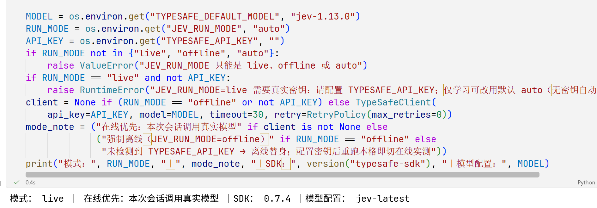
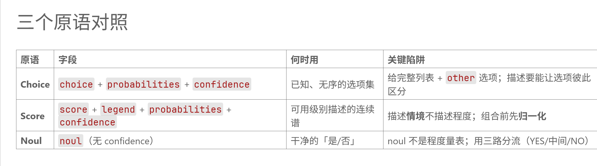
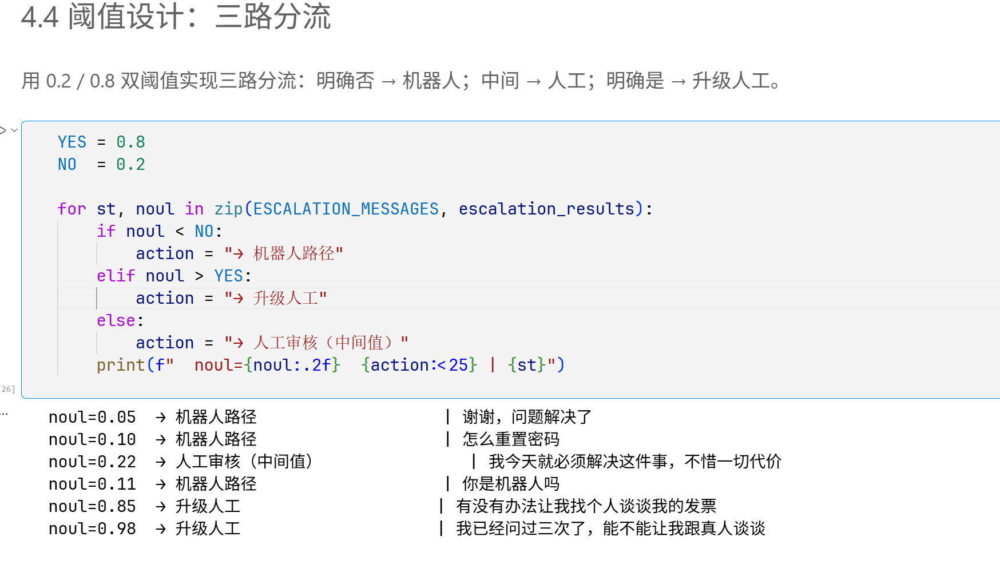
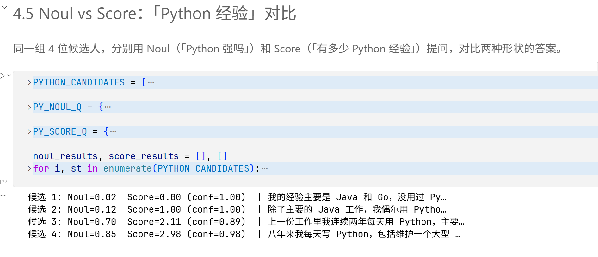
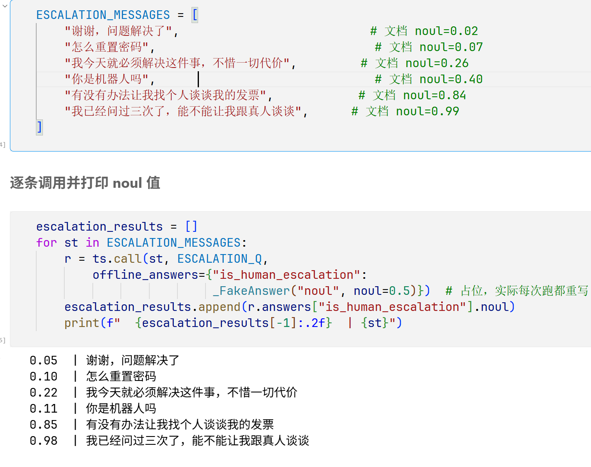

# 第二章 · 核心概念 学习笔记

> 章节：核心概念（五册：01 System One → 05 应用构建）
> 环境：Windows 11 + VS Code + Python 3.12.4（全局解释器），typesafe-sdk 0.7.4
> 运行模式：**live（真实调用）**
> 模型：请求 `jev-latest`，服务端回显 `jev-1.13.0`
> 实验笔记：`main/02_核心概念/01_SystemOne.ipynb` … `05_应用构建.ipynb`
> 数值出处：本文所有具体数值都来自我本机 live 运行的输出或截图。《02 状态》这一册我没有留下运行数值，该节只记实验设计。

---

## 一、这一章在讲什么

第一章看到的是一次类型化判断，本章把它拆成一条完整数据流：

**state → 问题与答案空间 → 概率分布 → 置信度 → 策略 → 动作**

五册就是按这条链路切开的：

| 册 | 核心问题 | 一句话结论 |
|---|---|---|
| 01 System One | 一个请求如何绑定 state 和多个问题？ | 问题 ID 只是键，改 ID 不影响判断 |
| 02 状态 | 哪些证据应该进入判断？ | 证据的量比表达格式重要得多 |
| 03 原语 | 是不是、选哪项、程度多少分别怎么表示？ | 三种形状各管一件事，Noul 没有 confidence |
| 04 置信度 | 概率分布如何转成可用的不确定性信号？ | confidence 是分布形状的压缩，不是最大概率 |
| 05 应用构建 | 怎样把判断嵌入受代码控制的流程？ | 代码组织流程，模型只做狭窄判断 |

第一章只讲了概率、置信度、正确性是三件事，本章把第四个概念补上了：**校准**。概率是模型给某个结果的质量；置信度是接口给的分布摘要；正确性要拿带标签的样本去判；校准是群体性质——长期看，报 0.8 的那些预测里约有 80% 会发生，但单个 0.8 的预测照样可能错。

还有一条边界要记住：**state 是本次判断可见的证据集合，不等于提示词全文**。设计 state 时同时要考虑信息是否充分、有没有无关信息干扰、以及有没有把不该给模型看的东西（标签、未来结果、权限外的数据）塞进去。

## 二、01 System One：一次请求绑定 state 和多个问题

### 2.1 三个 Noul 问一次

state 是订单 A-104：两笔各 49 美元、状态 `captured` 的重复扣款，加上客户的退款请求和一段中文退款政策。一次调用问三个 `Noul`：

```python
REFUND_QUESTIONS = {
    "refund_requested":       Noul(instructions="客户是否明确要求退款？"),
    "duplicate_charge":       Noul(instructions="是否存在重复扣款？"),
    "policy_supports_refund": Noul(instructions="退款政策是否支持本次退款？"),
}
```

结果：`refund_requested = 0.99`、`duplicate_charge = 0.95`、`policy_supports_refund = 0.98`。

第三个问题的 instructions 里直接引用 state 里的交易与政策事实，**不引用前两个问题的预测结果**。这一点是刻意的：一次请求里三个问题共享同一份证据，但我不能据此认为它们在数学上独立。

### 2.2 概率交给代码，代码才做决定

Notebook 里先跑一段纯确定性检查（恰好两笔、ID 唯一、都是 `captured`、金额相等），再用阈值组合：

```python
DECISION_THRESHOLD = 0.8
# 三个概率全部 ≥ 0.8 → 路由到 refund_review，否则 review
```

三个都过线，路由结果是 `refund_review`（建议进入退款审核流程）。

这里的分工和第一章一致：**模型给出 0.99 / 0.95 / 0.98，是我代码里的 0.8 把它们变成了「进审核」这个动作**。而且三问全过也不代表可以自动转账——金额、权限、幂等、支付接口的约束仍然归业务系统。Notebook 里还专门提醒了一句：**把几个概率乘起来不等于「总体成功概率」**，因为「独立提问」不等于「统计独立」。

### 2.3 控制实验：只改问题 ID

把问题 ID 从 `refund_requested` 改成 `q1`，instructions 一个字都不动，state 也不动：

| | 概率 |
|---|---|
| 原 ID `refund_requested` | 0.99 |
| 新 ID `q1` | 0.99 |
| 绝对差 | **0.0** |

返回体里回显的 ID 是 `['q1']`。结论很清楚：**问题 ID 是给我自己用的键，不承载语义**。改 ID 不会改变模型的判断，只是让返回结果按新的键来索引。

### 2.4 执行台账



```
"mode": "live", "real_calls": 2, "offline_calls": 0
```

| case | 耗时 | input / output tokens |
|---|---|---|
| 退款三问 | 0.243 s | 501 / 58 |
| 问题 ID 对照 | 0.235 s | 426 / 21 |

耗时只是当次网络的快照，不能当性能结论用；token 数的对比倒是稳定可读的：三个问题合在一次请求里问，比分开问要多花 input，但省掉了往返。

## 三、02 状态：哪些证据该进入判断

这一册做的是控制变量，两组的改动点不同。**我没有留存这一册的运行数值，所以下面只记设计，不列概率。**

### 3.1 控制实验 A：只改表达格式

固定同一段客户消息和同一个订单号，问题也固定，只把 state 换成三种序列化形态：

- 字符串：`"订单号：A-104。客户消息：" + MESSAGE`
- 对象：`{"order_id": "A-104", "message": MESSAGE}`
- 数组：`["订单号：A-104", "客户消息：" + MESSAGE]`

这组的价值在于它是一个干净的单变量实验：事实没变、问题没变，变的只是「怎么说」。教材随附的输出显示三种格式的结果差异很小（这一册我没有自己的运行记录，所以不列数值），我的读法是——**格式会影响结果，但幅度很小，不能靠换格式去提高准确率**；它真正影响的是我怎么组织 state（比如用对象来给字段命名，后面加字段才方便）。

### 3.2 控制实验 B：固定格式，补充事实

这一组的改动是「证据的量」，也是这一册里差距最大的：

- 最小 state：只有客户消息 + 订单号。
- 完整 state：再补上客服回复、两笔交易记录（各 49 美元、`captured`）、退款政策。

问题是一个 `Choice`，三个选项 `supported / unsupported / insufficient`，instructions 里要求「不要补造缺失事实」，并显式留了 `insufficient` 这个出口。

我从这里学到的是**出口选项的重要性**：只要给了「信息不足」这个选项，模型在材料不够时就会走到它，而不是硬猜一个「不支持」；补上交易与政策之后，主选项才会翻到「支持」。这两步在教材随附的输出里都看得到（同样，这一册我不列数值）。

### 3.3 字段白名单

`RAW_RECORD` 里带着 `expected_label`、`split`、`internal_note` 这些字段，`make_state()` 只放行 `message` 和 `order_id`，并用 assert 断言标签类和划分类的字段不会进入 state。

这一节**不发起模型调用**，是纯确定性代码。它给我的启发是：state 的构造应该像特征工程一样有白名单，而不是把整条数据库记录塞进去。把标签泄漏给模型，后面所有评估都不作数。

## 四、03 原语：是不是 / 选哪项 / 程度多少

这一册是我截图最多的一册：下面 4.4 / 4.5 / 4.6 三处的数字都能在对应截图里直接对照，其余数值来自同一册我实跑留下的输出。

### 4.1 三种原语的字段形状不一样



| 原语 | 字段 | 何时用 | 关键陷阱 |
|---|---|---|---|
| `Choice` | `choice` + `probabilities` + `confidence` | 已知、无序的选项集 | 要给完整列表 + `other` 出口，描述要让选项彼此可区分 |
| `Score` | `score` + `legend` + `probabilities` + `confidence` | 可用级别描述的连续谱 | 描述情境不描述程度；组合前先归一化 |
| `Noul` | `noul`（**无 confidence**） | 干净的「是 / 否」 | noul 不是程度量表，配三路分流用 |

### 4.2 同一 state，三种切法

同一条故意写得很杂的支持工单（重复扣款 + 登录不上 + Apple Pay），一次调用同时问三件事：

```
category           (Choice)
   choice = 'billing'
   probs  = {'billing': 0.85, 'feature_request': 0.03, 'bug_report': 0.04, 'account': 0.08}
   conf   = 0.80
severity           (Score)
   score  = 1.77    （概率加权期望值，可为小数）
   probs  = {0: 0.0, 1: 0.23, 2: 0.77}
   conf   = 0.66
refund_requested   (Noul)
   noul   = 0.12    （没有 confidence 字段！）
```

三个观察：

1. `Score` 的 1.77 是 `0×0.0 + 1×0.23 + 2×0.77` 算出来的期望分，不是单独给的另一个数——**分数是从分布里推出来的**。
2. `Noul` 只有一个 `noul` 字段，它确实没有 `confidence`。它的不确定性只能靠「离 0 或 1 有多远」来读。
3. 「重复扣款」这个信息把 `category` 拉到了 `billing`，而工单里其实还提了登录问题。我的读法是：**state 写得越杂，单个问题越容易被其中某一条细节带着走**，所以「只送相关上下文」不只是省 token 的事。

### 4.3 一次调用问五个：同一份证据里 confidence 跨度很大

§2.2 把一条复杂工单拆成五个问题，一次请求问完，762 input tokens：

| 问题 | choice | confidence | 概率分布 |
|---|---|---|---|
| `return_reason` | `wrong_size` | **0.99** | 单峰 0.99 |
| `shipping_issue` | `delayed` | 0.81 | `delayed` 0.86 |
| `tone` | `frustrated` | 0.59 | `frustrated` 0.73 / `angry` 0.27 |
| `department` | `billing` | **0.44** | `billing` 0.63 / `returns` 0.35 双峰 |
| `requested_resolution` | `refund` | **0.36** | 四家分票：`refund` 0.53 / `information` 0.29 / `exchange` 0.15 / `replacement` 0.03 |

同样是「把工单路由到部门」这种问题，§2.1 那条更简单的工单上 conf 是 1.00（选中 `returns`）；换到这条更复杂的工单上就掉到 0.44。**「一次问多个问题能省钱」是真的，但每个问题可确定的程度差得很远**，不能只看那个被选中的标签。

### 4.4 Noul 的阈值决策：三路分流



六条客户消息，同一个 `Noul` 问题（客户是否在要求人工坐席），实跑值：

```
noul=0.05  → 机器人路径     | 谢谢，问题解决了
noul=0.10  → 机器人路径     | 怎么重置密码
noul=0.22  → 人工审核（中间值） | 我今天就必须解决这件事，不惜一切代价
noul=0.11  → 机器人路径     | 你是机器人吗
noul=0.85  → 升级人工       | 有没有办法让我找个人谈谈我的发票
noul=0.98  → 升级人工       | 我已经问过三次了，能不能让我跟真人谈谈
```

阈值是 `YES = 0.8`、`NO = 0.2`。

两条值得记的：

- **只有 0.22 那条落进了中间档。** 「我今天就必须解决这件事，不惜一切代价」听起来很急，但它并**没有要求转人工**——模型判的是「要不要人工」，不是「有多急」。问题问错了，情绪再强烈也不会给出高 noul。这正好说明 `Noul` 不能用当程度量表。
- 中间档的存在是有用的：0.22 既不满足「明确否」也不满足「明确是」，落到人工审核而不是被硬塞进某一个分支。

### 4.5 Noul vs Score：同一批人，两种问法



同 4 位候选人、同一份简历文本，分别用 `Noul`（「Python 能力很强」）和 `Score`（4 级经验量表）各跑一遍：

| 候选人 | Noul | Score | confidence | Score 分布 |
|---|---|---|---|---|
| 1（只会 Java/Go） | 0.02 | 0.00 | 1.00 | L0 = 1.00 |
| 2（偶尔写脚本） | 0.12 | 1.00 | 1.00 | L1 = 1.00 |
| 3（两年日常用） | 0.70 | 2.11 | 0.89 | L2 = 0.89, L3 = 0.11 |
| 4（八年满级） | 0.85 | 2.98 | 0.98 | L2 = 0.02, L3 = 0.98 |

`Noul` 把候选 3、4 都放在「强」这一侧（0.70 / 0.85，差距 0.15），`Score` 才把它们分成 2.11（日常使用）和 2.98（接近满级）。**两者互补，不能互相替代**：要「过不过线」用 `Noul`，要「在第几级」用 `Score`。而且候选 3、4 的分布形状也说明 `Score` 的分数会落在两个等级之间，不是硬贴到某一级上。

顺带记一个 `Score` 的坑：§3.5 把三个维度加权组合时，三个量表的级数不一样（severity 3 级、frustration 3 级、report_quality 4 级）。先各自归一化再加权，得到优先级 0.589；如果直接把原始分数相加，4 级量表的那一项会被放大近一半。

### 4.6 参考值和实跑值不一致的地方



这张图里代码注释标的是教材给的参考值（`# 文档 noul=`），下面是实跑输出：

| 消息 | 注释里的参考值 | 我实跑的 |
|---|---|---|
| 谢谢，问题解决了 | 0.02 | 0.05 |
| 怎么重置密码 | 0.07 | 0.10 |
| 我今天就必须解决这件事 | 0.26 | 0.22 |
| **你是机器人吗** | **0.40** | **0.11** |
| 有没有办法让我找个人谈谈我的发票 | 0.84 | 0.85 |
| 我已经问过三次了 | 0.99 | 0.98 |

差距最大的是「你是机器人吗」：参考值 0.40（接近「说不准」），实跑 0.11（明确判为不是转人工诉求）。教材 §4.3 自己也把这条解释成中文语义更确定——英文原例 "Are you a robot?" 偏中间，中文这句话在客服语境里更像是随口一问。

同类的不一致在这一册里还有一处：§3.4 的 severity 对照表写着第三个案例 `conf = 0.41`，而同一册实跑打印出来的是 `0.25`，且那次的分布是**精确的 50/50**（`{1: 0.5, 2: 0.5}`）——正好卡在两个级别中间，所以置信度塌了下去。这说明**正文表格沿用的还是内置的离线样例值，没有在 live 重跑后更新**。

教训：代码注释和正文表格都只是参考，**以自己跑出来的为准**。

### 4.7 结构化输入

§5 演示了三种结构化写法：`instructions` 里给结构化字段（发票号 / 金额 / 账期，实跑 `invoice_number_is_correct = 0.99`、`amount_due` 与 `payment_terms` 的 score 都是 2.00、conf 都是 1.00）；`Choice` 的选项用 `field / not_for / examples` 消歧（`return_status` 与 `return_policy` 这类容易混的选项，实跑 probs 是 `{return_policy: 0.0, return_status: 1.0}`、conf 1.00）；以及分类树逐层遍历（商品分类实跑 `运动户外` 0.99、conf 0.98）。

## 五、04 置信度：分布形状的压缩

### 5.1 confidence 不是最大概率

这一册最干净的一个控制实验是手工构造的两组分布：

| 分布 | max_p | 熵 |
|---|---|---|
| 单峰 `{0.6, 0.13, 0.13, 0.14}` | 0.600 | 1.112 |
| 双峰 `{0.6, 0.4, 0, 0}` | 0.600 | 0.673 |

**两组的最大概率完全一样，但形状不同。** 只看 `argmax` 的话这两种情况一模一样；而直觉上「0.6 领先，第二名 0.4 紧追」应该比「0.6 领先，其余都很小」更不确定。

实跑印证了这一点：

| 输入 | conf | max_p | 差 | 第二名概率 |
|---|---|---|---|---|
| 明确 | 1.000 | 1.000 | +0.000 | 0.000 |
| 明确 | 1.000 | 1.000 | +0.000 | 0.000 |
| 明确 | 1.000 | 1.000 | +0.000 | 0.000 |
| 三件套（登不上 + 晚到 + 重复扣款） | **0.400** | 0.550 | **−0.150** | **0.430** |
| 无关（「你好」） | 0.950 | 0.960 | −0.010 | 0.020 |

「三件套」那一条 `max_p = 0.550`（`account`）但 `conf` 只有 0.400，因为第二名 `billing` 有 0.43——**confidence 是分布形状的压缩，max_p 只是分布里的一个点**。

### 5.2 三路分流

用 `HIGH_CONF = 0.9`、低阈值 `0.5` 把 5 条工单分流：4 条（conf ≥ 0.95）自动路由，只有「三件套」conf 0.40 转人工。

这里要注意的是：**中间档几乎没被触发**。5 条里 4 条落在 0.95–1.00，剩下 1 条直接掉到 0.40，0.5–0.9 之间一条都没有。这跟本册 §3 的情况是同一件事（见 5.5）。

### 5.3 措辞是置信度的强控制变量

同一段 state、同一套 `criteria`，只改 `instructions` 的措辞精确度：

| 版本 | instructions | conf | max_p | choice | 相对变化 |
|---|---|---|---|---|---|
| v1 | 判断这条支持工单的大类 | 0.840 | 0.880 | `billing` | 基线 |
| v2 | 判断首要问题类别（忽略次要话题） | 0.710 | 0.780 | `billing` | −0.130 |
| v3 | 判断第一个提到的问题属于哪个部门，按叙述顺序 | 1.000 | 1.000 | `billing` | +0.160 |

**改措辞只动置信度，不动标签**——三个版本的 `choice` 全是 `billing`。v3 把「按客户叙述顺序」这个消歧规则写进 instructions，置信度直接拉满，也就意味着这一条不会再触发转人工。

这条经验对工程很有用：**该问什么、按什么规则消歧，是写在 instructions 里的，而它直接决定了要走多少人工**。

### 5.4 层级 fallback：信心高报细类，信心低报粗类

10 条工单，`CONFIDENT_THRESHOLD = 0.9`：conf ≥ 0.9 报细类，否则降级报粗类。实跑结果 9 条报细类、1 条降级（「能不能换个颜色」，conf 0.75），**0 条被丢弃、0 次额外调用**。

这解决的是「不知道该怎么办」的问题：与其丢掉低置信度的样本，不如退一个更粗但仍然可用的标签。教材引用原 cookbook 的数据说 60 份文档准确率从 65% 提到 80% 且不增加调用——但那个数字我没有标注集去复现，只记策略本身。

### 5.5 参考值和实跑值不一致的地方

§3.4 的正文写「查余额 / 批准转账 / 模糊」三条的 conf 分别是 高 / 0.82 / 0.45，风险不同所以阈值不同（批准转账要 0.9 以上）。我实跑的三条**全是 1.00**：

```
我的账户余额是多少      → 'check_balance'    conf=1.00
确认批准那笔五万的转账  → 'approve_transfer' conf=1.00
嗯…那个…关于我的账户    → 'support'          conf=1.00
```

中文「嗯…那个…关于我的账户」这种故意含糊的输入，被模型以 conf 1.00 归到了 `support`，分布是 `{check_balance: 0.0, approve_transfer: 0.0, support: 1.0}`。

所以这个「风险调整阈值」的演示在我这次运行里**没有产出中等置信度的样本**——三条都直接走了各自的分支，没有一条走到「兜底转人工」。结合 5.2 的观察，我的读法是：**在中文短文本上，模型的置信度倾向于两极，中间档很难自然出现**。这对三路分流的设计有直接影响，也是我目前最没底的一点（见第八节）。

和 §3.4 一样，正文那张表用的也是内置离线样例值（里面 0.82 / 0.45 这类中间值），没有在 live 重跑后更新。

## 六、05 应用构建：把判断嵌进受代码控制的流程

### 6.1 三种架构与八条设计建议

| 架构 | 谁组织下一步 |
|---|---|
| 传统软件 | 预先编写的分支 |
| LLM 智能体 | 模型参与选择动作与工具 |
| **AI 驱动的软件** | **代码组织流程，模型提供狭窄判断** |

本章走第三条。八条建议串起来是：能用代码就用代码；只送相关上下文；给输入命名；分解问题；必要时结构化 instructions 和 criteria；批量提出独立问题；代码组合；按不确定性路由。

其中有两条是纯代码的活，这一册里也有对应演示：逾期天数 52 天 → 建议 `collections_review`，是直接算的；而带着标签、划分字段的记录要经过白名单过滤才允许进 state。

### 6.2 完整客服分流

8 个案例，`closed` 的那条不调 API 直接跳过，其余 7 条各发一次请求：

| 案例 | 路由结果 |
|---|---|
| closed | `no_action`（未调 API） |
| billing | `billing`（`refund_requested = True`） |
| orders | `orders`（`mentions_open_order = True`） |
| account_normal | `account_normal` |
| account_high | `account_high` |
| quarantine | `quarantine`（risk 0.89） |
| review_spam | **`account_normal`（偏离预期）** |
| review_topic | `review_topic`（risk 0.043） |

路由函数 `decide_route()` 的骨架是：先按三个 Noul 加权算出一个风险分，风险分卡在中间区间 → 送复核；然后按 `topic` 的 confidence 门控（低于 0.75 进复核）；再按风险分高 → 隔离；最后才按主题分派。**这是一棵用概率搭起来的决策树，每一层的阈值都是我自己写的。**

实跑里门控确实起作用了：8 个案例的 topic confidence 只有 `review_topic` 是 0.72（< 0.75）而进了复核，其余都 ≥0.95（billing / orders / account 都是 1.0）。`account_high` 和 `account_normal` 的区分靠的是 `frustration`：前者的 `score = 2.0, conf = 1.0, {0: 0.0, 1: 0.0, 2: 1.0}`，后者接近 0。

### 6.3 覆盖率台账：漏了一个分支

这一册我最想记下来的一个设计是 `COVERAGE`——把「预期会被走到的路由」和「实际走到的路由」对一遍：

```json
{
  "expected": ["account_high", "account_normal", "billing", "no_action",
               "orders", "quarantine", "review_spam", "review_topic"],
  "observed": ["account_high", "account_normal", "billing", "no_action",
               "orders", "quarantine", "review_topic"],
  "missing": ["review_spam"],
  "source": "live"
}
```

预期 8 条、实际 7 条，**`review_spam` 这个分支一次都没被走到**。原因是那个刷单案例的信号不够中间：`unexpected_reward = 0.62`、`sender_identity_mismatch = 0.28`，加权之后没落进 `0.4 < risk < 0.6` 这个复核区间，于是被当成了正常工单。

结论很实用：**用概率做门控时，得自己算覆盖率，不能假设每个分支都会被走到**。测试集跑完一路绿灯，可能只是那条分支的触发条件写得太窄，而不是真的没问题。

### 6.4 分解工具调用轨迹

这一册的最后一个配方是复刻「查西雅图天气」那条轨迹：请求要的是华氏度，而工具调用参数里写的是摄氏度。做法是把轨迹拆成 9 个独立的 `Noul` 命题，让模型逐条判断：

| 命题 | noul |
|---|---|
| `geocode_tool_is_relevant` | 0.97 |
| `geocode_location_matches` | 0.99 |
| `geocode_arguments_match_schema` | 0.98 |
| `geocode_result_matches_call` | 0.97 |
| `weather_tool_is_relevant` | 0.41 |
| `weather_arguments_match_schema` | 0.63 |
| `weather_uses_geocoded_coordinates` | 0.98 |
| `weather_date_matches` | 0.99 |
| **`weather_unit_matches`** | **0.02** |

9 项里只有单位那一条是低值，正好定位到问题所在；`weather_tool_is_relevant` 的 0.41 和 `weather_arguments_match_schema` 的 0.63 是中间值，说明这两项本身有歧义。

同时用确定性代码独立核对一次单位（`trace.tool_calls[1].arguments.unit == request.unit`），结果是 `False`——**和模型的判断一致**。这两条路径互为交叉验证：模型负责在模糊的地方给概率，代码负责在能算的地方给确定答案，两者对不上就是值得查的信号。

### 6.5 执行台账

```
"mode": "live", "real_calls": 12, "offline_calls": 0
```

12 次调用 = 7 次分流 + 5 次配方，与案例数对得上。7 次分流的 input 都在 976–994 tokens、output 稳定是 144，耗时 0.22–0.58 s；5 次配方的调用量小得多（最小 329 input / 24 output tokens）。**一条工单里的 7 个问题是在一次请求里评估完的，不是发 7 次**——这就是批量提问省下来的东西。

## 七、小结：控制变量的三种改法

把这一章所有实验按「改了什么」归一下类，其实只有三种：

| 改什么 | 在哪一册 | 结果方向 |
|---|---|---|
| 改 state 的**表达形式** | 02 实验 A（字符串 / 对象 / 数组） | 影响很小，不能靠换格式提高准确率 |
| 改**证据的量** | 02 实验 B（补交易与政策）、04 §4（改 instructions 措辞） | 影响很大：前者能翻转主选项，后者把 confidence 从 0.71 拉到 1.00 |
| 改**问题与选项** | 01（改 ID）、03（换原语）、05（加门控） | ID 无影响；换原语改变的是信息种类；门控改变的是动作 |

表里 02 的两行来自教材随附输出（这一册我没有自己的运行数值），其余各行都是我实跑得到的。

配一句刹车：以上都只是我在少数样例上观察到的变化。README 的练习 1 要求区分「观察到的变化」和「对所有任务的推断」——**我改一条 criteria 的措辞看到概率动了，不能推断说这个模型对所有任务都这样**。样本量、抽取方式、标注集都没有，这些观察只能当设计手感，不能当评估结论。

另外，这一章反复出现的一件事是：**模型给概率，代码给策略**。0.8 / 0.75 / 0.9 这些数字没有一个是模型给的，全是我写在代码里的，而它们直接决定了走多少人工、漏多少分支。

## 八、遗留问题

1. **中文短文本下置信度两极分化。** 04 册里 5 条工单全落在 0.40 或 ≥0.95，§3 的三条银行指令全是 1.00，中间档几乎抓不到样本。那三路分流的中间档在中文业务里还剩多少用？我不知道是不是我的样本太极端了。
2. **阈值只能靠试。** 0.8 / 0.75 / 0.9 都是示例值，没有标注样本支撑。真正部署时怎么定，还没接触。
3. **覆盖率缺口没有系统找法。** 05 册漏掉 `review_spam` 是我把预期路由写全了才发现的；如果预期集合本身就写漏了，就没有任何机制会提醒我。
4. **校准只有概念，没有实践。** 正文提到 Brier、ECE、reliability diagram，但我没有真实标注集，画不出来，也没法判断这些概率到底准不准。
5. **`Noul` 的置信度怎么参与策略？** `Choice` 和 `Score` 有 confidence 可以直接门控，`Noul` 只有一个标量，只能看它离 0.5 多远。这三种原语的不确定性怎么放进同一套阈值体系，我还没有答案。

---

### 参考

- 本章笔记：`main/02_核心概念/README.md`
- 五册 Notebook：`main/02_核心概念/01_SystemOne.ipynb` → `05_应用构建.ipynb`
- 官方文档：<https://docs.typesafe.ai/introduction>
- 中文参考站：<https://datawhalechina.github.io/jev-cookbook/introduction/>
- 上一章笔记：[第一章 · 认识 Jev 学习笔记](../task1/第一章-认识Jev-学习笔记.md)
