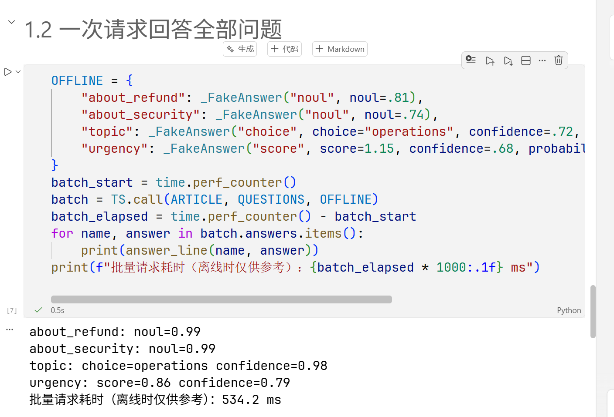
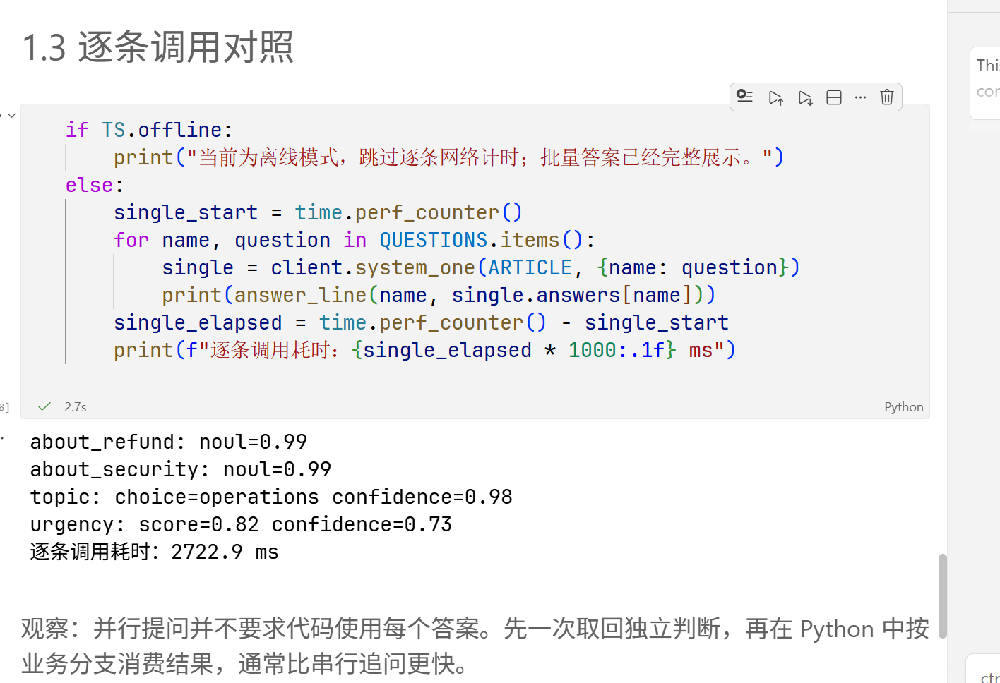
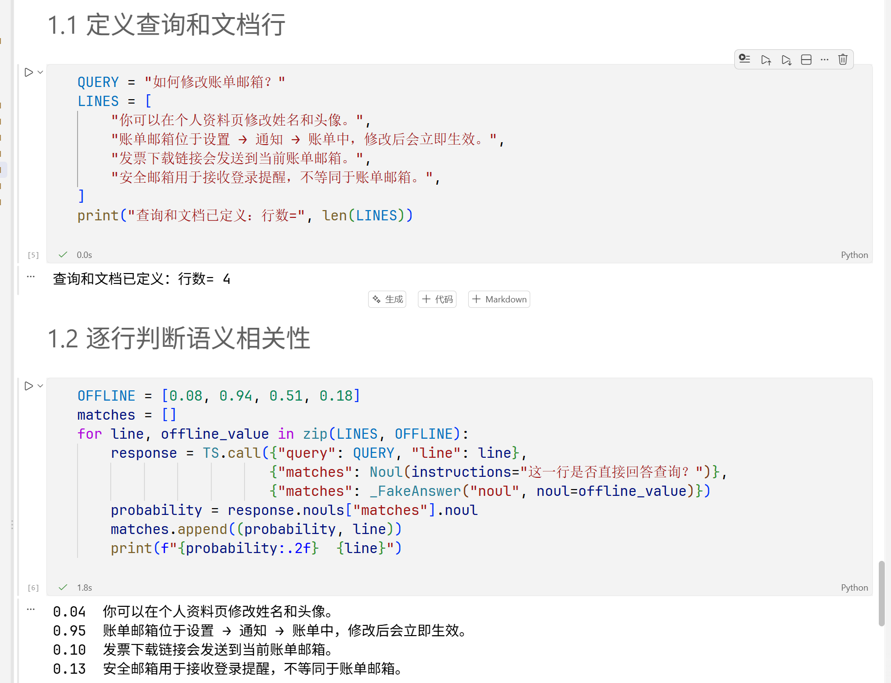
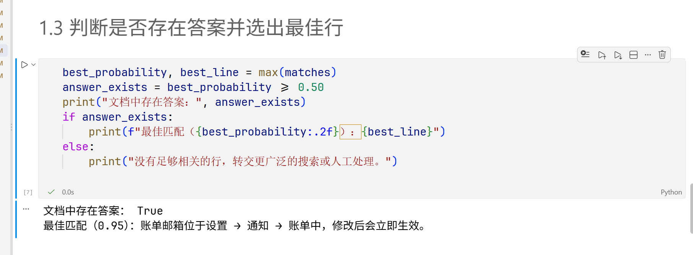
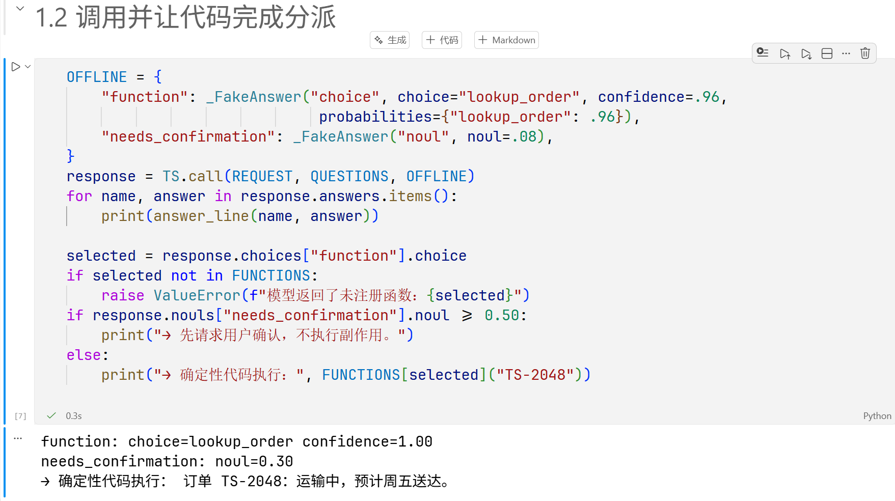

# 第四章 · 实战指南 学习笔记

> 章节：实战指南（18 篇 Cookbook）
> 环境：Windows 11 + VS Code + Python 3.12.4（全局解释器），typesafe-sdk 0.7.4
> 运行模式：**live（真实调用）**为主，其中两篇误跑成离线
> 模型：请求 `jev-latest`，服务端回显 `jev-1.13.0`
> 实验笔记：`main/04_实战指南/01–18_*.ipynb`
> 数值口径：只写本次实测到的；没跑到的篇目只讲配方机制，不给任何数值。

---

## 一、这一章在讲什么

前三章是拆解：第一章看一次类型化判断，第二章拆成 state → 问题 → 分布 → 置信度 → 策略 → 动作，第三章把这套东西接进程序架构。

第四章不再讲新概念，而是**给出 18 个已经能用的配方**。每篇都是同样的四步：

**state（这次判断能看到什么）→ 类型化问题（允许怎么答）→ 代码（怎么用这个答案）→ 一个可观察的现象**

18 篇可以按要解决的问题分成四条路线，这也是本章 README 给的分法：

| 路线 | 篇目 | 要解决的事 |
|---|---|---|
| 判断稳定性与分流 | 01、02、18 | 同一个问题问多次，答案稳不稳；不稳的样本交给谁 |
| 检索与证据 | 03、04、05、10、11 | 召回之后怎么排序、怎么定位、怎么验证证据 |
| Agent 与风险控制 | 07、08、12、13 | 该调用哪个工具、该拦哪条输入、该不该升级 |
| 结构化处理 | 06、09、14、15、16、17 | 在已有候选或片段上做有限选择，再由代码拼出结构 |

我按这四条路线组织笔记。每条路线里，每篇只写三件事：**它判断什么、代码怎么用这个判断、我看到了什么**。

## 二、证据口径（先看这张表）

18 篇里我真正跑出真实结果的是 5 篇，两篇跑成了离线，其余 11 篇没跑。写之前必须先把这条界线划清楚：

| 状态 | 篇目 | 本文怎么处理 |
|---|---|---|
| **live 实测** | 03 并行提问、04 重排序、05 逐行语义搜索、07 函数调用、10 RAG 段落分类 | 给数值，逐条可回查 Notebook 输出格或任务目录里的截图 |
| **跑成离线** | 01 自一致性 Noul、02 自一致性 Choice | 只写机制与阈值，**不写数值**——那两篇的输出是 Notebook 内置的示例答案（客户端打印的是 `Key= 未配置（将使用离线示例）`），不是模型给的 |
| **没跑** | 06、08、09、11、12、13、14、15、16、17、18 | 只写配方机制和代码里写死的阈值，不给任何运行数值 |

离线替身不会分析输入，它返回的是写死的一组常量。所以凡是标「离线」或「未跑」的地方，`0.7`、`0.60` 这类数字都是**代码里的参数**，不是模型的输出。

## 三、判断稳定性与分流（01、02、18）

这三篇解决同一个问题的三个层次：判断本身抖不抖 → 抖动怎么变成动作 → 抖动在生产里怎么用。

### 3.1 01 自一致性 Noul：同一问题问五次

**配方**：一份车险理赔的 state（三个字段），五个 `Noul` 问题——是否承保、是否可修、是否有欺诈信号、是否符合租车条件、是否该转人工。同一份 state 连续调用 5 次，收集每次的标量，再算均值与标准差。

**代码怎么用**：

```python
def noul_decision(probability):
    if 0.30 <= probability <= 0.70:
        return "uncertain"
    return "yes" if probability > 0.70 else "no"
```

0.30–0.70 之间判「不确定」，两侧判是/否。这里有两道门：重复 5 次算出的 `stdev` 说明**稳不稳**，均值落在哪一段说明**答的是什么**。

**我的看法**：`stdev` 小只能说明模型对这个问题很笃定，不能说明答案对。一个稳定地答错的问题，标准差同样是 0。自一致性回答的是「值不值得再问一次」，不是「答得准不准」。另外 5 次调用把成本乘了五倍，这一篇没有测这件事值不值。

（本篇的 5 次输出是离线示例，数值不作为模型证据。）

### 3.2 02 自一致性 Choice：投票会丢分布

**配方**：一条有争议的社区帖子，三个 `Choice`——该采取什么审核动作、进哪个队列、严重程度。同样重复 5 次，但这次保留每次的 `choice` **和** `confidence`。

**代码怎么用**：

```python
def choice_decision(answer, threshold=0.60):
    return answer.choice if answer.confidence >= threshold else "uncertain"
```

**我的看法**：这一篇和上一篇的分岔点在于「多数票」这个陷阱。五个 `Choice` 里如果四个选 `escalate`、一个选 `keep`，按多数票就是 `escalate`；但那一次的 `keep` 可能带着 0.51 的置信度，说明模型在那次看到的是另一种读法。只数票数会把这个信号抹掉。保留 `confidence`，阈值才有东西可切。

### 3.3 18 基于置信度的分类：把门控做成生产形态

**配方**：五家中文公司简介，一道 `Choice` 给出行业组（商业银行、证券资管、保险、软件、硬件、制药、零售、物流），阈值 `CONFIDENT = 0.9`。

**代码怎么用**：置信度 ≥ 0.9 时直接报**行业组**；低于阈值就回退报**大类**（金融保险 / 信息技术 / 医药健康 / 贸易运输），并打印「由哪个组回退而来」。再往下才是人工。

这就是第二章「层级 fallback」的完整版：

```
行业组（细）  ——conf ≥ 0.9——→ 直接采用
   ↓ conf < 0.9
大类（粗）     → 至少还落在正确的域里
   ↓ 仍不确定
人工复核
```

**我的看法**：这个设计的价值不在「准」，而在**错了也错在附近**。直接把五家硬分进八组，错一家就是错到另一个行业；先退到大类，错的代价小一档。它的前提是大类的划分比细类稳定——这一点我没有数据验证。

## 四、检索与证据（03、04、05、10、11）

RAG 的五个环节，这里各有一篇，可以按顺序读：**03 一次问全 → 04 排序 → 05 定位到行 → 10 过滤段落 → 11 核对引用**。

### 4.1 03 并行提问：一次请求问四件事

**配方**：一句 29 字的产品公告，四个问题一次问完——是否提到退款（Noul）、是否提到安全审计（Noul）、主要主题（Choice：产品/运营/政策）、紧迫程度（Score 三级）。

**实测**：

| | 一次批量 | 逐条 4 次 |
|---|---|---|
| `about_refund` | 0.99 | 0.99 |
| `about_security` | 0.99 | 0.99 |
| `topic` | `operations`，conf 0.98 | `operations`，conf 0.98 |
| `urgency` | **0.86**，conf **0.79** | **0.82**，conf **0.73** |
| 耗时 | **534.2 ms** | **2722.9 ms** |

逐条是批量的 **5.1 倍**耗时。这是本次唯一一组能直接对比的耗时数据。





**两个观察**：

1. **耗时差 5.1 倍，答案几乎一样——但不完全一样。** 前三个答案连置信度都一致，只有 `urgency` 从 0.86/0.79 变成了 0.82/0.73。同一份 state、同样的措辞，换一次调用方式，分数就动了。这说明 0.86 与 0.82 之间的差距落在波动范围里，不能拿来比较「哪种问法更准」。
2. 这组数据只有 4 个问题、一轮。第三章那次是 5 问、4.6 倍；这次 4 问、5.1 倍。两次都指着同一个方向，但都不能当性能结论——网络、服务端排队、当次负载都混在里面。

### 4.2 04 重排序：给已召回的候选打分

**配方**：查询「如何撤销一笔尚未结算的转账？」，四个候选段落，每个候选单独问一道 Noul：「这段候选内容是否直接回答用户的问题？」

**实测**：

| 排名 | 相关度 | 判定 | 候选 |
|---|---|---|---|
| 1 | **0.88** | 推荐 | 你可以在转账详情页点击撤销；已结算的转账需要联系客服。 |
| 2 | 0.11 | 低相关 | 如果转账已经结算，收款方需要主动退回资金。 |
| 3 | 0.07 | 低相关 | 退款通常会在五个工作日内原路返回。 |
| 4 | 0.03 | 低相关 | 银行卡挂失后，请在安全中心重新设置登录密码。 |

门槛 0.50，四个候选里只有一个过线。

**两个观察**：

1. **同一个候选，离线示例和实跑差了 0.67。** 第 2 条「如果转账已经结算，收款方需要主动退回资金」在内置示例里是 **0.78**（会被判「推荐」），实跑只有 **0.11**。这条差别不是四舍五入级别的——它把判定从「推荐」翻成了「低相关」。所以离线示例值不能拿来预判模型行为，连大致排序都不行。
2. 第 2 条在语义上确实沾边（讲的是转账撤销的另一种情况），模型给 0.11 说明它读的是「是否直接回答这个查询」，不是「是否属于相关话题」。问题措辞决定了排序的粒度，这一点比阈值更影响结果。

### 4.3 05 逐行语义搜索：先定位行，再判断有没有答案

**配方**：查询「如何修改账单邮箱？」，四行文档，逐行问「这一行是否直接回答查询？」（Noul）。拿到四行概率后，取最大值，与 0.50 比较，判断文档里到底有没有答案。

**实测**：

| 相关度 | 行 |
|---|---|
| 0.04 | 你可以在个人资料页修改姓名和头像。 |
| **0.95** | 账单邮箱位于设置 → 通知 → 账单中，修改后会立即生效。 |
| **0.10** | 发票下载链接会发送到当前账单邮箱。 |
| 0.13 | 安全邮箱用于接收登录提醒，不等同于账单邮箱。 |

判定：**文档中存在答案 = True，最佳匹配 0.95**。





**两个观察**：

1. **第 3 行是边界项，而且被离线示例误导过。** 「发票下载链接会发送到当前账单邮箱」在内置示例里是 **0.51**（刚好过 0.50 门槛），实跑是 **0.10**。如果只按示例值写阈值，会以为这一行算「直接回答」——实际上它只是在同一个话题上。
2. 两行都提到了「账单邮箱」（第 2、4 行），但只有第 2 行回答的是「怎么改」，第 4 行是在区分两个概念。问题写成「是否直接回答查询」，模型才能把这两行分开；如果写成「是否与账单邮箱相关」，第 4 行大概率会被抬上去。

### 4.4 10 RAG 段落分类：四道 Noul 加一个 first-match 路由

**配方**：查询是「如何重置密码？我只用手机号登录，没有绑定邮箱」。六段语料（两段官方帮助、一段旧版说明、一条论坛帖、两段无关文档），每段问四个 Noul：

- `relevant`：是否在讨论查询的主题
- `usable_evidence`：是否陈述了可直接用于回答的信息
- `contradicts_premise`：是否与查询里当作事实的前提相矛盾
- `instructs_model`：是否试图指挥负责回答的系统

阈值：注入 0.70 / 矛盾 0.70 / 相关下限 0.45 / 证据下限 0.55。路由按**固定顺序首次命中**：

```python
if instructs_model > 0.70:   return "drop"        # 注入优先
if contradicts_premise > 0.70: return "conflicting"
if relevant < 0.45:          return "drop"        # 无关
if usable_evidence > 0.55:   return "usable_evidence"
return "drop"
```

**实测**：

| 路由 | relevant | usable | contra | inject | 段落 |
|---|---|---|---|---|---|
| usable_evidence | 0.98 | 0.98 | 0.09 | 0.14 | doc-reset |
| usable_evidence | 0.92 | 0.88 | 0.12 | 0.15 | doc-email |
| **usable_evidence** | **0.95** | **0.84** | **0.41** | 0.22 | **doc-contradict** |
| drop | 0.77 | 0.17 | 0.18 | **0.97** | forum-injection |
| drop | 0.02 | 0.03 | 0.11 | 0.17 | doc-billing |
| drop | 0.17 | 0.06 | 0.12 | 0.16 | doc-2fa |

汇总：`usable_evidence 3 / conflicting 0 / drop 3`。

**三个观察**：

1. **「冲突」这条分支一次都没命中，而它本该命中的那一段进了可用证据。** `doc-contradict` 的正文是「重置密码只能通过绑定邮箱完成……未绑定邮箱的账号无法自助重置」，而查询里明确说了「没有绑定邮箱」——这是硬矛盾。但模型给的 `contradicts_premise` 只有 **0.41**，低于 0.70，于是按顺序落到 `usable_evidence`。最终拼出来的提示词里，「冲突信息」一栏是**「（无）」**。
2. 这一段的 `relevant` 是 0.95、`usable` 是 0.84，说明模型认为它「跟话题高度相关、也陈述了可用信息」——它只是没把「与我说的前提矛盾」这一层读出来。**四个 Noul 里有一个偏低，整个路由就改道了**；first-match 的顺序保护不了这种情况，因为矛盾判断排在最前面却没过线。
3. 注入那条是干净命中的：`forum-injection` 的 `instructs_model` 拿到 **0.97**，远高于 0.70，直接丢弃，没有进入提示词。这说明「把段落当不可信文本」这层防护在本例里是有效的。

另外，这一篇只**打印**提示词，不调用生成模型——它验证的是「该把哪些段落放进上下文」，不是「答案好不好」。

（本篇数值来自 Notebook 执行输出，没有截图。）

### 4.5 11 引用核查：字符串检查放在模型前面

**配方**：一份产品安全说明，五条引用。每条先做**确定性检查**——把引文规范化空白后，在源文档里做子串匹配：

```python
def locate(source, citation):
    needle = normalize(citation["quote"])
    if needle and needle in normalize(source):
        return "found", source
    return "missing", None
```

找不到就是 `missing`，直接判 `fabricated`，**不调模型**。找到的才问一道 Choice：`supports` / `contradicts` / `says_nothing`，置信度 ≥ 0.8 自动接受，否则进人工复核。

**我的看法**：这一篇的顺序最重要——**能用字符串判断的先判，判不了的再问模型**。捏造引文（引号里的内容根本不在原文里）是模型最不该碰的任务：它没有理由判断一段不存在的文字和某个论断什么关系。把它挡在模型前面，既省调用又不会漏。这和第五章以后要讲的「确定性检查与模型判断互为交叉验证」是同一个思路。

（本篇未跑，无实测数值。）

## 五、Agent 与风险控制（07、08、12、13）

四篇都围绕同一个问题：**模型给出一个信号，谁来执行、执行什么、出错了怎么办**。

### 5.1 07 函数调用：选函数的是模型，执行的是代码

**配方**：请求「请查询订单 TS-2048 的物流状态，并告诉我预计送达日期。」函数目录三个（查订单 / 退款 / 改地址），两个问题：该执行哪个函数（Choice）、执行前是否需要用户确认（Noul）。

**实测**：

```
function: choice=lookup_order confidence=1.00
needs_confirmation: noul=0.30
→ 确定性代码执行： 订单 TS-2048：运输中，预计周五送达。
```



**代码怎么用**——三步，每一步都是代码在把关：

```python
selected = response.choices["function"].choice
if selected not in FUNCTIONS:                      # 1. 白名单校验
    raise ValueError(f"模型返回了未注册函数：{selected}")
if response.nouls["needs_confirmation"].noul >= 0.50:   # 2. 副作用前确认
    print("→ 先请求用户确认，不执行副作用。")
else:
    print("→ 确定性代码执行：", FUNCTIONS[selected]("TS-2048"))   # 3. 代码执行
```

**我的看法**：这一篇的关键不是「模型选对了」，而是**模型即使选错也执行不了**。`selected` 只是一个字符串，它要被查表命中才会执行；不在表里直接抛错。函数的参数（`"TS-2048"`）也是代码传的，不是模型生成的。这跟第一章讲的「生成式模型负责写，Jev 负责判」是同一件事，只是这里落到了副作用上。

`needs_confirmation` 这次是 0.30，低于 0.50，所以直接执行了。换个请求（比如「退款」）这个值大概会上去——但我没有测。

### 5.2 08 技能推荐：先宽召回，再精选

**配方**：请求「帮我把本周会议纪要整理成行动项，并安排下周跟进会议。」四个技能（日历 / 会议纪要 / 任务 / 邮件）。

两步：

1. **宽召回**：每个技能问一道 Noul「这个技能是否可能帮助完成请求？」，按概率取前三名
2. **精选**：在前三名里问一道 Choice「哪个候选技能最适合先处理请求？」，置信度 < 0.60 交人工

**我的看法**：第二阶段的 `criteria` 是**由第一阶段的输出生成的**——`{name: SKILLS[name] for name in SHORTLIST}`。这是一个可以推广的写法：选项空间不必写死在代码里，可以由上一层的判断收窄。代价是第一阶段漏掉的技能，第二阶段再也不会出现；召回的上限就是最终结果的上限。这和检索里的 Recall@K 是同一个约束。

（本篇未跑，无实测数值。）

### 5.3 12 LLM 防护栏：判定与策略分开

**配方**：六条消息（普通、越狱、危害请求、医疗诊断、自伤、边缘医疗），每条同时问四个 Noul（越狱 / 有害请求 / 医疗建议 / 自伤）和一个 Score（若照做，可能造成多大伤害，四级）。

判定完之后，四类风险各自映射到动作：

```python
HAZARD_ACTION = {"jailbreak": "block", "harmful_request": "block",
                 "medical_advice": "review", "self_harm": "support"}
PRECEDENCE = ["support", "block", "review", "pass"]
```

两套策略只差一个数：

| 策略 | 转复核阈值 | 执行动作阈值 |
|---|---|---|
| strict | 0.35 | **0.70** |
| permissive | 0.35 | **0.85** |

**我的看法**：这一篇最值得记的是**判定和策略是两层**。模型只输出「这条消息有多像越狱」这样的概率，`route()` 才决定 0.70 就算拦截还是 0.85 才算。换策略不用重新调模型，只要改一个字典——这一点和第三章「阈值是业务政策，不是模型事实」完全一致。

`PRECEDENCE` 那条也值得注意：一条消息同时触发多个风险时，`support` 排在 `block` 前面。这是业务决定（自伤信号优先走求助通道），不是概率能算出来的结论。

（本篇未跑，无实测数值。）

### 5.4 13 SDE 级联：逐字段验证，够了就停

**配方**：一张干净的电子发票，和一个「mini 小模型提取」的结果（文档 A 提取正确，文档 B 幻觉了总额与备注）。对每个字段问一组验证 Noul：`hallucinated`（该值是否源文本不支持）、`name_desc_mismatch`（是否与字段名不符）、`missing_in_source`（该有值却缺失）。

门控就一行：

```python
FIRE_T = 0.7   # 任一字段 P(wrong) > 0.7 → 升级

def any_flag(checks, threshold=FIRE_T):
    return {qid: p for qid, p in checks.items()
            if not str(qid).startswith("__overall__") and p > threshold}
```

没有字段触发 → 保留 mini 的提取结果（成本最低的那一档）；有一个触发 → 升级。`__overall__` 那条被显式排除在门控之外，只作为参考信号。

**我的看法**：级联的关键是**触发条件写成可数的字段级信号**，而不是一个「整体质量分」。整体分一旦掉下去，你不知道该重跑哪一步；字段级的 `P(wrong)` 能直接告诉你是 `total` 出错还是 `notes` 幻觉。`FIRE_T = 0.7` 这个数同样是政策——调低会升级更多、更稳也更贵。

（本篇未跑，无实测数值。）

## 六、结构化处理（06、09、14、15、16、17）

这五篇的共性最强：**模型不做组装，只做有限选择；拼接、算术、格式全部由代码完成。**

### 6.1 06 结构恢复：判断相邻两行是不是一句话

**配方**：五段被错误换行的文本。对每一对相邻行问一道 Noul：「换行是否把同一个句子切开了？」

```python
paragraphs = [LINES[0]]
for index, probability in enumerate(joins):
    if probability >= 0.50:
        paragraphs[-1] += LINES[index + 1]   # 拼接由代码做
    else:
        paragraphs.append(LINES[index + 1])
```

**我的看法**：模型输出的只是一个「要不要连」的布尔倾向，段落本身是代码拼出来的。这比让模型「输出恢复后的整段文字」安全得多——后者一旦漏字或改字，你无从发现；前者每一行的原文都没离开过代码。

（本篇未跑，无实测数值。）

### 6.2 09 实体对齐：一档 Score 决定动作

**配方**：四对中文啤酒实体（同一款、完全不同的、相关的、易混淆的）。一道 `Score` 分三档：不同产品 / 相关但可能不同 / 同一款；外加三个 Noul 做字段级旁证（名称、酒厂、风格是否一致）。

**代码怎么用**：

```python
LEVELS  = [不同产品, 密切相关但可能不同, 完全同一款]
OUTCOME = {0: "leave unlinked", 1: "curator queue", 2: "assert sameAs"}

def route(score_value):
    level = min(int(score_value + 0.5), len(LEVELS) - 1)   # 四舍五入落档
    return OUTCOME[level]
```

**我的看法**：`score` 是概率加权的期望值，可能是 1.92 这种落在档位之间的数。**「四舍五入到最近的一档」这个决定是代码做的**，模型只给期望值。另外，进到 `curator queue` 时会拼出「名称不一致 / 酒厂不一致 / 风格不一致」的提示——那三个 Noul 在这一档才有用武之地，是给人工看的解释，不参与路由。

（本篇未跑，无实测数值。）

### 6.3 14 日期抽取：模型读部件，代码算日期

**配方**：七道 Choice 读日期的**形态与部件**——写法（绝对 / 相对 / 未提及）、月、日、年、日锚点、星期、周偏移。没有一道题要求模型做算术。

```python
def assemble(parts, today=TODAY):
    ...
    confidence = min(usable)      # 取所用部件的最小置信度
    needs_review = confidence < 0.60 or ...
```

**我的看法**：三件事分得很干净——**识别**（模型读「下周四」这几个字）、**解析**（代码算 `next` 是哪一周）、**拼装**（`date` 对象）。置信度取**最小**而不是平均，因为一个部件读错，整条日期就废了；平均会把错误稀释掉。`TODAY` 被固定成常量，相对日期才可复现——这是做可重复实验的必要条件。

（本篇未跑，无实测数值。）

### 6.4 15 预解析值抽取：候选由正则给，模型只在候选里选

**配方**：先用正则**高召回**地抓候选（邮箱、电话、金额），再让模型从候选里挑。每个挑选题都有一个逃生口 `NONE = "none"`（「没有候选合适」）。

```python
EMAIL_RE = re.compile(r"[A-Za-z0-9._%+-]+@[A-Za-z0-9.-]+\.[A-Za-z]{2,}")
MONEY_RE = re.compile(r"(?:[$€£¥]\s?\d[\d,]*(?:\.\d{2})?|\d[\d,]*(?:\.\d{2})?\s?元)")
```

**我的看法**：这个顺序把模型的职责压到了最小——它不做「找出邮箱」这种容易编造的任务，只在三个真实存在的字符串里选。`NONE` 那个逃生口是必要的：正则把「账单别名」`billing@xinghe.cn` 和「个人邮箱」都抓出来了，模型要能说「这些都不是」。没有逃生口，四选一一定会硬选一个。

（本篇未跑，无实测数值。）

### 6.5 16 层级分类：贪心下行 vs 束搜索

**配方**：一棵中文商品分类树（数码 / 家电 / 服饰，每层三四个子类），三条商品描述。两种走法：

- **贪心下行**：每层问一道 Choice，选最大的那个往下走，一层一次调用
- **束搜索 K=2**：同时保留两条最优路径，最后比路径分

路径分用的是**几何平均**（每一步概率的连乘再开 n 次方），不是连乘——连乘会让层数越多的路径分越低，不同深度的路径就没法比。

**我的看法**：贪心和束搜索的差别不在「谁更准」，在**调用次数和纠错能力**。贪心在某层选错就一路错到底，无法回头；束搜索多花调用换一次回头的机会。这一篇要看的正是「多花的那些调用买到了什么」——但具体买到了多少，得跑出来才知道。

（本篇未跑，无实测数值。）

### 6.6 17 自动研究特征发现：问题是特征

**配方**：几条酒和咖啡的品鉴笔记，六个 Score（果香强度、橡木/烘焙、酸度、酒体、余味、平衡）加一个 Noul（是否提到缺陷），装成一张特征表。然后跑一个极简基线：

```
预测分 ≈ 78 + 平均强度 × 4.5 − 6 × 是否提及缺陷
```

**我的看法**：这一篇的标题比内容大——**「自动研究」的循环并没有真的跑**，Notebook 只做到「把文本变成数值特征表」这一步。但它把第三章「复合评分」的思路用到了另一个方向：不是给人打分，而是**给文本打特征**，供下游任何模型使用。`_uncert` 那一列（`1 - confidence`）也有用——不确定性本身可以当特征喂进去。


## 七、小结：18 篇共用的骨架

读完 18 篇，配方各不相同，骨架是同一套：

| 环节 | 18 篇里的做法 | 谁决定 |
|---|---|---|
| 看到的证据 | state 里只放这次判断合法、必要的东西 | 我 |
| 允许怎么答 | Noul 是非 / Choice 分类 / Score 程度，选项写死在请求里 | 我 |
| 怎么用答案 | 阈值、路由表、白名单、回退层级 | 我 |
| 出错的退路 | 低置信转人工、回退到粗类、抛错、不执行副作用 | 我 |
| 组装与副作用 | 拼接、算术、格式化、执行函数 | **代码** |

模型在这张表里只占一列：给出类型化的值和概率。

四条路线读下来的顺序建议（和 README 一致）：

- **RAG**：03 → 04 → 05 → 10 → 11。03 省往返，04 排候选，05 定位到行，10 过滤上下文，11 做最后的证据核对。
- **Agent**：07 → 08 → 12 → 13。07 是单步工具选择，08 是召回加精选，12 是输入侧防护，13 是输出侧验证。
- **结构化**：06 → 09 → 14 → 15 → 16 → 17。全部是「模型做有限选择，代码拼结构」。

还有一条贯穿全章的判断方法：**先问这一步的正确答案是不是查表/匹配能得到的**。11 的捏造引文、15 的电话号码、07 的函数名白名单，都是能用确定性代码解决的；确定性能解决的，就不要交给概率。

---

### 参考

- 本章说明与 18 篇地图：`main/04_实战指南/README.md`
- 实验 Notebook：`main/04_实战指南/01–18_*.ipynb`
- 教程总览与阅读路线：`main/README.md`
- 官方文档：<https://docs.typesafe.ai/introduction>
- 中文参考站：<https://datawhalechina.github.io/jev-cookbook/introduction/>
- 上一章笔记：[第三章 · 架构模式 学习笔记](../task3/第三章-架构模式-学习笔记.md)
