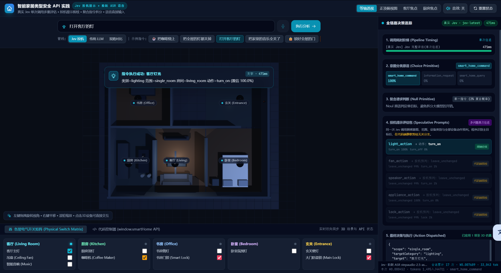
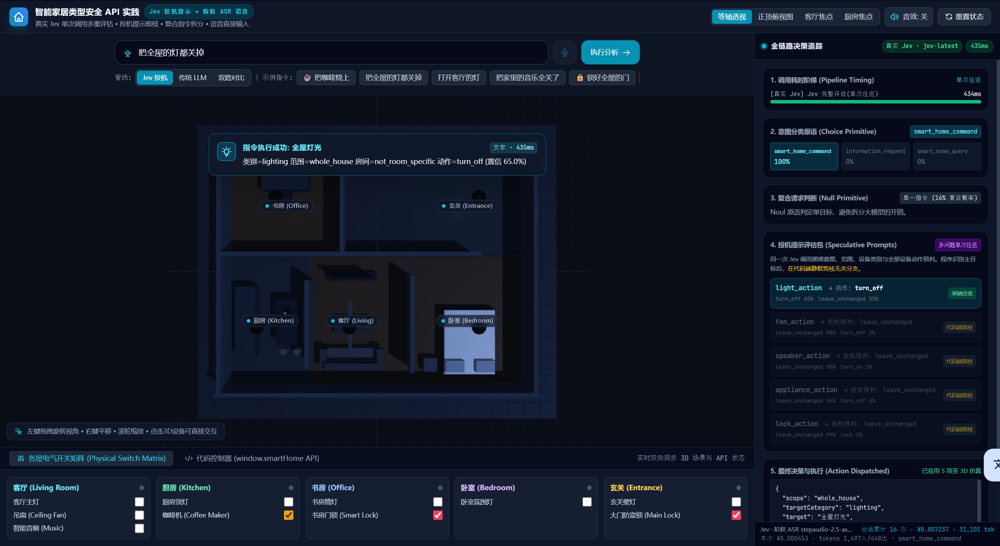
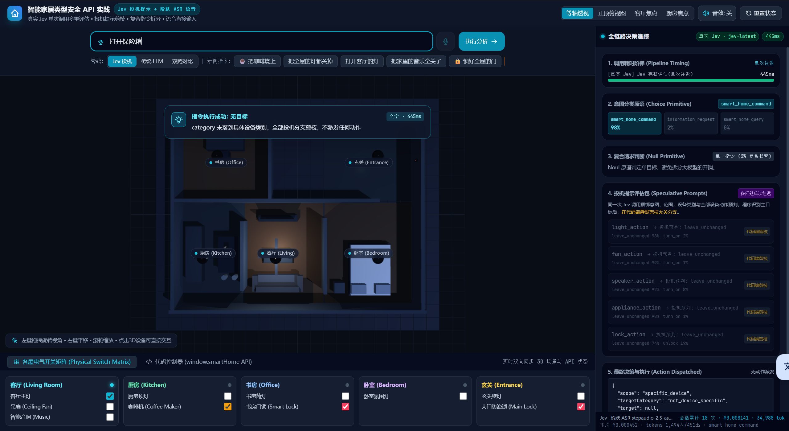
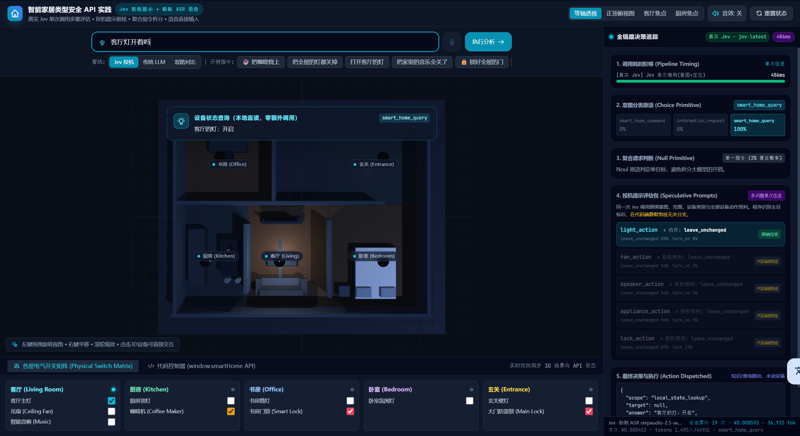
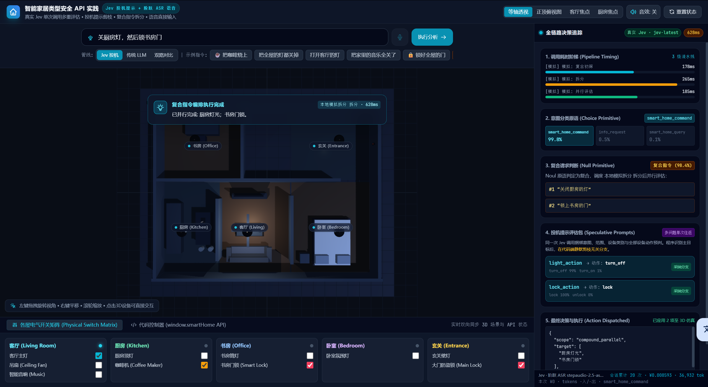

# 第五章 · 智能家居实验 学习笔记

> 章节：智能家居实验（类型安全 API 实践）
> 环境：Windows 11 + VS Code + Python 3.12.4（全局解释器），浏览器打开本地服务
> 运行模式：网页应用实时调用 Typesafe SystemOne；阶跃（语音 / 对话）**未配置**
> 模型：界面回显 `jev-latest`
> 实验材料：`main/05_智能家居实验/`（Notebook、`smart_home_demo/` 前后端）
> 证据：本目录 5 张运行截图，同一会话连续 5 次，累计次数 16 → 20
> 数值口径：只写这 5 张截图上能直接读到的；没截图的地方只讲机制，不给数。

---

## 一、这一章在演示什么

前四章都是 Notebook 里的单点实验：一次请求、一段代码、一个输出格。这一章把那些零件装进一个能点的东西——一个 3D 户型、一个输入框、一个追踪面板。

链路是：

**用户一句话 → Jev 一次调用（意图 + 是否复合 + 范围 + 房间 + 类别 + 各个设备的动作预判）→ 代码剪枝与分流 → 3D 场景执行 → 面板留痕**

这条链路上"谁说了算"分得很清楚。模型只回答「这句话像什么」，回答形式是类型化的值和概率；**要不要真的动手、动哪几个设备、按什么顺序动，全在代码里**。本章 README 把这条边界写成一句话：模型提供语义信号，代码负责权限、规则、顺序和副作用。

我在这一章看到的是这句边界在四个不同出口上的样子：

| 模型给出的东西 | 代码做的事 | 截图 |
|---|---|---|
| 意图是命令，类别落到具体设备 | 派发动作，改 3D 状态 | 打开客厅的灯、把全屋的灯都关掉 |
| 意图是命令，但类别没落到任何设备 | 全部投机分支剪掉，一个动作都不派发 | 打开保险箱 |
| 意图是设备状态查询 | 用已拿到的 target 读本地状态，零额外调用 | 客厅灯开着吗 |
| `is_compound` 过阈值 | 拆分 → 编排 → 并行或串行执行 | 关厨房灯，然后锁书房门 |

---

## 二、我跑到哪一步

5 张截图来自同一个页面会话，右下角"会话累计"从 16 次走到 20 次，中间没有断开。其中**4 次是真实调用，1 次降级成本地模拟**（第五节单独说）。

| 次序 | 指令 | 耗时 | 本次成本 | 会话累计 |
|---|---|---|---|---|
| 16 | 把全屋的灯都关掉 | 435 ms | ¥0.000453 · 1,497 入 / 448 出 | ¥0.007237 · 31,101 tok |
| 17 | 打开客厅的灯 | 471 ms | ¥0.000452 · 1,495 入 / 447 出 | ¥0.00769 · 33,043 tok |
| 18 | 打开保险箱 | 445 ms | ¥0.000452 · 1,494 入 / 451 出 | ¥0.008141 · 34,988 tok |
| 19 | 客厅灯开着吗 | 486 ms | ¥0.000452 · 1,495 入 / 449 出 | ¥0.008593 · 36,932 tok |
| 20 | 关厨房灯，然后锁书房门 | 628 ms | ¥0 · 无 token | ¥0.008593 · 36,932 tok |

前四次每次 ¥0.000452–0.000453，累计差值相加也对得上：0.007237 + 0.000452 ≈ 0.00769，+ 0.000452 ≈ 0.008141，+ 0.000452 ≈ 0.008593。第五次**累计栏一分没动**，这一点在第五节会用到。

没有做的事，先说清楚：

- **我没跑 Notebook。** 所以本文没有一次请求的原始 JSON，也没有接口返回的 `upstream_ms`。面板上的耗时是浏览器端测到的往返时间。
- **阶跃那一路没有配 Key。** 语音输入（右上角显示"语音 关"）、复合指令拆解、常识问答、传统 LLM 对照、双路对比这五处，在本机都是不可用的状态。
- 5 条指令都是一次一条手工输入，没有做重复性测试。

---

## 三、一次调用里塞了什么

面板第 4 块叫"投机提示评估包"，右上角标着"多问题单次往返"。一次请求同时问 5 个设备动作问题，代码只看落地的那个类别对应的问题，其余四个直接剪掉。

把 5 次运行的分布排开看：

| 指令 | `light_action` | `fan_action` | `speaker_action` | `appliance_action` | `lock_action` |
|---|---|---|---|---|---|
| 打开客厅的灯 | **turn_on 100% / turn_off 0%** ✅ | leave 99% / on 1% | leave 99% / on 1% | leave 100% / on 0% | leave 99% / lock 1% |
| 把全屋的灯都关掉 | **turn_off 65% / leave 35%** ✅ | leave 98% / off 2% | leave 98% / on 1% | leave 94% / off 6% | leave 99% / lock 1% |
| 打开保险箱 | leave 98% / on 2% | leave 99% / on 1% | leave 92% / on 8% | leave 98% / on 1% | leave **74%** / unlock 1% |
| 客厅灯开着吗 | leave 89% / on 8% ✅ | leave 96% / on 2% | leave 96% / on 3% | leave 94% / on 5% | leave 87% / lock 13% |

（✅ 是界面上标"采纳分支"的那一条；其余四条标"代码端剪枝"。）

三件可以直接读到的事：

**第一，被剪掉的四支几乎都是 `leave_unchanged` 的高分。** 92%–100% 之间，代码连看都不用细看——"让风扇保持原样"本来就是最安全的默认值。真正有信息量的是剩下的几个百分点：说"开客厅灯"时 `lock_action` 上 lock 还剩 1%，说"客厅灯开着吗"时 `lock_action` 上 lock 高到 13%、`light_action` 上 turn_on 还有 8%。**这句话越不像动作，答案就越往"别动"那边靠。**

**第二，"采纳分支"不等于"派发动作"。** "客厅灯开着吗"这一条，`light_action` 被标成采纳分支，但面板第 5 块的决策是：

```json
{"scope": "local_state_lookup", "target": null, "answer": "客厅的灯：开启"}
```

`target` 是 null，`dispatchedActions` 一条都没有。投机答案在这里只用来**定位是哪盏灯**，状态本身是从本地 3D 场景里直接读的。界面给"客厅的灯：开启"打的标签是"设备状态查询（本地直读，零额外调用）"。

**第三，一次问六个问题，成本几乎恒定。** 4 次真实调用的输入 token 按运行次序是 1,497 / 1,495 / 1,494 / 1,495，输出 448 / 447 / 451 / 449，钱都是 ¥0.000452–0.000453。指令从"开客厅灯"变到"打开保险箱"，问的问题一个没少、也没多。这和第三章那个「批量 vs 逐条」的对照是同一件事：**往返次数省下来的不是钱，是时间**——四次耗时都在 435–486 ms 之间。

---

## 四、代码拿回判断之后

### 4.1 单房间 vs 全屋：同一族指令，两种确定程度





两条都是灯、都是命令、意图都给到 100%，差别只在覆盖范围：

| | 打开客厅的灯 | 把全屋的灯都关掉 |
|---|---|---|
| 类别 / 范围 / 房间 | lighting / single_room / living_room | lighting / whole_house / not_room_specific |
| 动作与置信度 | turn_on **100.0%** | turn_off **65.0%** |
| `light_action` 分布 | turn_on 100% / turn_off 0% | turn_off 65% / **leave_unchanged 35%** |
| `is_compound` | 2% | 16% |
| 决策 | `{"scope":"single_room","targetCategory":"lighting","target":"客厅灯光"}` | `{"scope":"whole_house","targetCategory":"lighting","target":"全屋灯光"}` |
| 落地的设备数 | 1 项 | 3 项 |

两条并排放着，最显眼的是那个 **65%**。同一句"关灯"，加上"全屋"这两个字之后，动作置信度从 100% 掉到 65%，`leave_unchanged` 从 0% 涨到 35%，复合概率从 2% 涨到 16%。

我只跑了两条，不能从两条样本推规律。我能说的只有：**这一个 case 上，指令覆盖范围变大时，模型对这个动作的把握明显变低了**，而代码没有为此停下来——65% 依然过了派发的门槛，一次关掉 3 项。如果给"全屋"这种范围单独设一条更高的门槛，这一条就会变成"再确认一次"。这正是第三章"置信度门控"那套东西的位置。

### 4.2 无目标：模型说了话，代码没动手



「打开保险箱」。意图判定 `smart_home_command` 98%、`information_request` 2%。`is_compound` 3%，单一指令。

有意思的是五个投机分支：**`lock_action` 上 `leave_unchanged` 只有 74%**，是四次运行里最低的一个数值，其余四个分支都在 92% 以上。也就是说模型读懂了"保险箱"是个锁，它确实往 lock 那边推了一把。

但 `category` 这一问落在了 `not_device_specific`——户型里没有保险箱这个设备类别。于是代码走了这一支：

> 类别未落到具体设备类别，全部投机分支剪枝，不派发任何动作

结果条写的是"**指令执行成功: 无目标**"，面板第 5 块：

```json
{"scope": "specific_device", "targetCategory": "not_device_specific", "target": null}
```

3D 场景一点没动——客厅灯、厨房咖啡机、书房门锁全都维持原位。

这是全章我最想记的一条：**模型每一问都答了，而且答得不算离谱，但没有一个答案能变成动作，因为类别没落到设备上。** 决定"什么都不做"的不是模型，是 `resolveDispatch` 里那句类别映射查不到就返回空——一处纯确定性的查表。

顺带一个界面上的观察：这一屏的结果条用的是"成功"两个字。从代码路径上说它确实走完了、没有报错；从使用者角度说，"打开保险箱"这个诉求没有被满足。

### 4.3 状态查询：用投机答案做定位，用本地状态做回答



「客厅灯开着吗」。意图三选一的分票非常干净：`smart_home_query` 100%，另外两个 0%。

代码拿到意图后没有再多发一次请求，「客厅的灯：开启」这句话里，**"哪盏灯"来自投机包里已经答好的 target，"开还是关"来自本地 3D 状态**。整条链路仍然只有一次 Jev 调用，486 ms，成本和一次普通命令一样。

这一屏和 4.1 的两屏放在一起看，就是投机提示的两半收益：**一半是省往返（一次问六个问题），一半是省第二次调用（问了的东西后面还能用上）**。

---

## 五、复合指令：我这一次降级了



「关厨房灯，然后锁书房门」。界面看起来很完整：三段耗时、"复合指令（98.4%）"、拆出两条子指令、两条投机分支都标了采纳分支、最后并行完成厨房灯光和书房门锁。

但这一屏的数值不是本次真实调用产生的。核对方式如下。

**耗时是三个固定值相加。** 面板第 1 块列出三段：178 ms / 265 ms / 185 ms，合计正好 628 ms。源码 `smart_home_playground.html` 里 `LocalSimulator.simulateCompoundRequest` 写的是：

```js
const typeSafeInit = 178, haiku = 265, parallel = 185;
```

**同一屏上其它数字也都能对上那几行写死的值。** 复合概率 98.4%、拆出的两条子指令文字（"关闭厨房的灯"、"锁上书房的门"）、`splitModel` 显示的"本地模拟拆分"、意图里 `smart_home_command` 的 99.8%，全部逐字一致。真实运行的四次，意图分布按运行次序分别是 100 / 100 / 98 / 0，都是模型给的数；这一屏是 99.8 / 0.5 / 0.1。

还有一处能看出来：真实调用的投机包固定是 5 条分支，这一屏只有 `light_action` 和 `lock_action` 两条——因为模拟路径只生成两条。

**为什么会降级。** 复合分支在拿到 `is_compound` 之后，要再调一次对话模型把整句拆成原子子指令（`/api/chat`）。服务端没配 `STEPFUN_API_KEY` 时这个接口返回 503，前端 `chatComplete` 抛错，`runEngine` 捕获后把整条链路降级到本地模拟：

```js
} catch (e) {
  ENGINE.degradedThisRun = true;
  const t = await LocalSimulator.evaluate(commandText);
```

**降级的代价是那次真实的判断被丢掉了。** 复合分支是先调 Jev 拿 `is_compound`、再调对话模型拆分的，抛错发生在第二次调用上，所以第一次的结果已经拿到了，但没有进面板，也没有计入 token。硬证据是第二节那张表的最后两行：第 19 次和第 20 次的会话累计完全相同（¥0.008593 · 36,932 tok）。如果第五次真的花了一次 Jev 调用的钱，累计栏不可能是这个样子。

**界面上怎么区分。** 看每段耗时前面的前缀：这一屏三段都顶着 `[模拟]`，真实运行那四屏是 `[真实 Jev]`。页面右上角的"真实 Jev · jev-latest"徽章是页面启动时根据健康检查确定的，和某一次具体运行走的哪条路无关；降级后这个徽章不会变。

所以这一屏能说明的事情只有一件：**在缺少对话模型的情况下，界面仍会把一个复合流程走完，并展示出一套完整的数值**。它不能用来证明真实链路下 `is_compound` 是多少，也不能证明拆出来的子指令是什么样。

至于真实的复合链路长什么样，只能从代码里读：拆出子指令之后，会再发一次 Jev 询问"谁必须在谁之前"，代码按回答建依赖图——有依赖就串行压栈、逐个等前一个完成；没有依赖就 `Promise.all` 并行。最终决策的 `scope` 相应写成 `compound_serial_stack` 或 `compound_parallel`。这一屏显示的是 `compound_parallel`，也就是"两条子指令两两无依赖"。这一段我这次没有真实数据。

---

## 六、启动与准备

这一章和前四章不一样：它不是一个 Notebook 跑完就结束，而是**前后端分离**——Python 起一个本地 HTTP 服务，浏览器打开页面，页面再回调这个服务的 `/api/jev` 去请求 Typesafe。

我整理下来的要点：

| 项 | 实际情况 |
|---|---|
| 启动 | `python serve_smart_home.py --port 8810`，默认端口 8810，加 `--no-open` 可以不自动开浏览器 |
| 前端 | 单个 HTML 文件，由服务直接吐出来，不用装 npm |
| 依赖 | 后端只用标准库，不需要 `pip install` |
| 必须的 Key | `TYPESAFE_API_KEY`。没有时 `/api/jev` 返回 503，页面整体退化成模拟引擎 |
| 可选的 Key | `STEPFUN_API_KEY`。决定语音、复合拆分、常识问答、传统 LLM 对照、双路对比五处能不能用 |
| 联网要求 | 页面从 CDN 取 three.js r128、OrbitControls、Tailwind，断网时 3D 场景出不来 |

有一点提前知道会省事：Notebook 里那三格是用 `subprocess.Popen` 起服务的，而且把 `stdout` / `stderr` 都丢进了 `DEVNULL`。**服务起不来的时候 Notebook 不会告诉你原因。** 第一次跑我建议直接在终端起服务，报错能看见；确认能起来之后再用 Notebook 的写法。

我把 Key 从已有的 IPython 启动文件里带进来，不需要写进任何仓库文件，也不用打印：

```bash
cd main/05_智能家居实验/smart_home_demo
python -c "
import os, runpy, subprocess, sys
runpy.run_path(os.path.expanduser('~/.ipython/profile_default/startup/00-jev-cookbook-env.py'))
subprocess.run([sys.executable, 'serve_smart_home.py', '--port', '8810'])
"
```

---

## 七、遗留问题

1. **没有做重复性测试。** 同一句话跑两遍，`light_action` 的分布会不会一样？第四章第 01 篇问的就是这件事，这一章我一条都没测。
2. **语音那一路完全没走通。** 除了没配 Key，代码里还有一层判断：局域网 IP 访问时浏览器禁用麦克风，得用 `--tls` 起自签证书的 https 服务。这两条我都没有验证。

---

### 参考

- 本章说明与实验设计：`main/05_智能家居实验/README.md`
- 实验 Notebook：`main/05_智能家居实验/01_智能家居实验.ipynb`
- 本地服务：`main/05_智能家居实验/smart_home_demo/serve_smart_home.py`
- 前端与投机/剪枝/降级逻辑：`main/05_智能家居实验/smart_home_demo/smart_home_playground.html`
- 教程总览与阅读路线：`main/README.md`
- 官方文档：<https://docs.typesafe.ai/introduction>
- 中文参考站：<https://datawhalechina.github.io/jev-cookbook/introduction/>
- 上一章笔记：[第四章 · 实战指南 学习笔记](../task4/第四章-实战指南-学习笔记.md)
